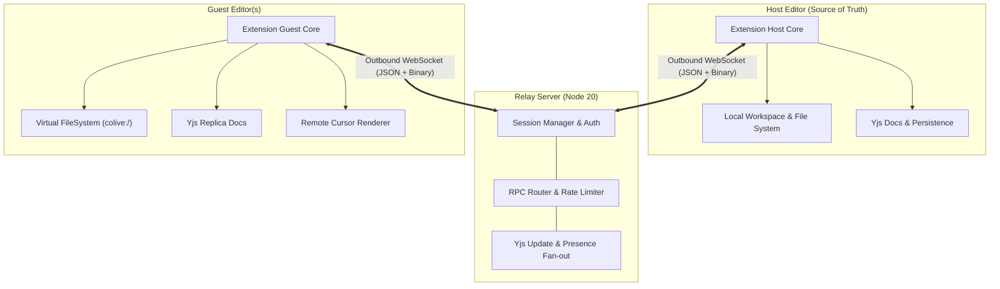

# CoLive

Real-time collaboration extension for VS Code-compatible editors (VS Code, Antigravity, Cursor, VSCodium).

[](https://github.com/colive/colive/actions/workflows/ci.yml)
[](LICENSE)

CoLive enables multiple developers to collaborate in real-time in the same workspace on a single machine's files:
- **Live Co-Editing**: Conflict-free real-time text editing powered by Yjs CRDTs.
- **Presence & Remote Cursors**: Color-coded carets, selections, name tags, and active file indicators.
- **Inline Code Comments**: Threaded discussions anchored to code ranges via the VS Code Comments API.
- **Follow Mode**: Smoothly follow another participant's editor navigation and viewport.
- **Session Chat & Diagnostics**: Integrated lightweight team chat and host-forwarded language diagnostics.
- **NAT & Firewall Traversal**: Outbound-only WebSocket connections to a central relay server.
- **End-to-End Encryption (E2EE)**: Optional zero-knowledge encryption using AES-GCM and HKDF.

---

## Architecture



---

## Getting Started

### Prerequisites
- Node.js 20+
- VS Code, Antigravity, Cursor, or VSCodium (^1.90.0)

### Development Setup
```bash
# Clone the repository
git clone https://github.com/colive/colive.git
cd colive

# Install dependencies across all workspaces
npm install

# Build all packages
npm run build

# Run tests
npm test

# Run linter
npm run lint
```

### Running the Relay Server Locally
```bash
npm run dev:server
# Server listens on http://localhost:8787 and ws://localhost:8787/ws
# Health check: curl http://localhost:8787/health
```

### Launching the Extension
Open this workspace in your editor (Antigravity or VS Code), go to **Run and Debug** (Ctrl+Shift+D / Cmd+Shift+D), and run **"Run Extension"** (F5).

---

## Telemetry
CoLive contains **zero telemetry** and collects no personal data or metrics.

---

## License
[MIT](LICENSE)
