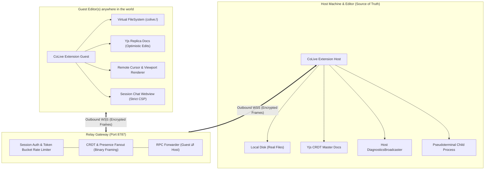

# CoLive 🚀

**Next-generation, real-time collaboration extension for VS Code-compatible editors (VS Code, Cursor, VSCodium).**

Work together in the same workspace on one machine's files anywhere in the world: live co-editing, remote cursors & selections, inline code comments, follow mode, session chat, shared diagnostics, and shared terminal.

[](https://github.com/MrNamra/CoLive/actions/workflows/ci.yml)
[](LICENSE)
[](https://code.visualstudio.com/)
[-success.svg)](docs/SECURITY.md)
[-brightgreen.svg)](#telemetry-guarantee)

---

## ⚡ Feature Matrix vs Microsoft Live Share

| Feature | Microsoft Live Share | CoLive |
| :--- | :--- | :--- |
| **Concurrency Engine** | Operational Transformation (OT) | **Yjs State-based CRDTs** (offline-safe, zero server state) |
| **Host Storage** | Local Disk Sync | **Atomic writes, fast-diff 3-way merge on external edits** |
| **Guest Filesystem** | Proprietary Virtual Drive | **Native `vscode.FileSystemProvider` (`colive:/`)** |
| **Self-Hosting** | ❌ No (Proprietary Azure Relay) | **✅ Yes (Single lightweight Node/Docker container)** |
| **End-to-End Encryption** | ❌ Transport-only (TLS to Azure) | **✅ Yes (WebCrypto HKDF-SHA256 + AES-256-GCM)** |
| **Code Privacy** | Transits proprietary cloud | **Zero code retained on server; zero telemetry** |
| **Terminal Sharing** | Proprietary multiplexer | **VS Code `Pseudoterminal` + host permission toggle** |
| **Inline Comments** | Proprietary comment widget | **VS Code Comments Controller + `RelativePosition` anchors** |
| **Diagnostics Sharing** | Language service proxy | **Real-time broadcast from Host `DiagnosticCollection`** |

---

## 🏗️ Architecture



---

## 🚀 Quick Start

### For Hosts (Sharing a Workspace)

1. **Open your project folder** in VS Code, Cursor, or VSCodium.
2. Click **"Share"** in the status bar (or press `Ctrl+Alt+L S` / `Cmd+Alt+L S`, or open Command Palette and run `CoLive: Share Workspace (Start Session)`).
3. Choose guest permission: **Read-Write** (collaborative) or **Read-Only** (review mode).
4. The invite link is automatically copied to your clipboard (e.g. `colive://join/81db8af1-aeb1-4cf3-a5af-f08f271b41e1#secret=...`). Share it with your teammates!

### For Guests (Joining a Session)

1. Open your editor and click **"Join"** in the status bar (or press `Ctrl+Alt+L J` / `Cmd+Alt+L J`, or run `CoLive: Join Collaboration Session`).
2. Paste the invite link or Session ID.
3. The host approves your request, and the shared workspace instantly opens in your editor under the virtual filesystem (`colive:/`)!

---

## ⌨️ Default Keybindings

CoLive registers a dedicated mnemonic chord prefix: `Ctrl+Alt+L` (Linux/Windows) or `Cmd+Alt+L` (macOS):

| Command | Chord | Action |
| :--- | :--- | :--- |
| `colive.share` | `Ctrl+Alt+L S` | Start sharing current workspace |
| `colive.join` | `Ctrl+Alt+L J` | Join a session with link or ID |
| `colive.stop` | `Ctrl+Alt+L X` | Stop hosting or leave session |
| `colive.follow` | `Ctrl+Alt+L F` | Toggle Follow Mode on selected peer |
| `colive.openChat` | `Ctrl+Alt+L C` | Focus CoLive Team Chat |
| `colive.copyInviteLink` | `Ctrl+Alt+L I` | Copy session invite link to clipboard |
| `colive.copyLineLink` | `Ctrl+Alt+L L` | Copy deep-link to current editor line |

---

## ⚙️ Configuration Settings

Customize CoLive via VS Code Settings (`settings.json`):

| Setting | Default | Description |
| :--- | :--- | :--- |
| `colive.serverUrl` | `ws://localhost:8787/ws` | WebSocket URL of the CoLive relay server |
| `colive.displayName` | `""` (System username) | Display name visible to participants |
| `colive.cursorColor` | `""` (Auto-assigned) | Preferred cursor color (hex) |
| `colive.defaultPermission` | `"readWrite"` | Default permission for joined guests (`readWrite` \| `readOnly`) |
| `colive.followMode` | `true` | Enable following when invited |
| `colive.showRemoteSelection` | `true` | Render semi-transparent remote selections |
| `colive.showRemoteCursorLabels` | `true` | Render name tags above remote carets |
| `colive.e2ee` | `true` | Enable End-to-End Encryption for document & awareness updates |
| `colive.autoSaveHost` | `true` | Persist Yjs document changes to host disk |
| `colive.saveDebounceMs` | `500` | Milliseconds to debounce disk writes on the host |
| `colive.excludePatterns` | `[".env*", "**/.git/**", "**/id_rsa*", "**/node_modules/**"]` | Glob patterns strictly blocked from guest reading/writing |

---

## 🐳 Self-Hosting in 60 Seconds

You can run your own dedicated, private relay server on Docker, Fly.io, Railway, or any Linux VPS.

### Docker Run

```bash
docker run -d \
  --name colive-relay \
  -p 8787:8787 \
  -e PORT=8787 \
  -e PUBLIC_URL=https://colive.yourdomain.com \
  -e MAX_PARTICIPANTS=20 \
  -e SESSION_TTL_HOURS=24 \
  --restart unless-stopped \
  ghcr.io/colive/relay:latest
```

### Docker Compose

```yaml
version: '3.8'
services:
  colive-relay:
    image: ghcr.io/colive/relay:latest
    ports:
      - "8787:8787"
    environment:
      - PORT=8787
      - PUBLIC_URL=https://colive.yourdomain.com
      - LOG_LEVEL=info
      - MAX_PARTICIPANTS=20
      - SESSION_TTL_HOURS=24
    restart: unless-stopped
```

Health check:
```bash
curl http://localhost:8787/health
# {"status":"ok","version":"0.1.0","protocolVersion":1}
```

Detailed deployment configurations (including Caddy with auto-HTTPS and Fly.io) are in [docs/DEPLOY.md](docs/DEPLOY.md).

---

## 🔒 Security & Privacy

For the complete security threat model and mitigation details, see [docs/SECURITY.md](docs/SECURITY.md).

1. **Zero-Knowledge Relay**: When E2EE is enabled (`colive.e2ee: true`), document updates, presence positions, and chat messages are encrypted with AES-256-GCM using keys derived via HKDF-SHA256 from the invite secret. The relay server cannot read or inspect code.
2. **Path Traversal & Symlink Escapes**: The host file service validates all incoming paths using `fs.realpathSync`, strictly enforcing that files reside inside the host's root workspace directory. Symlinks pointing outside the workspace are blocked.
3. **Sensitive File Exclusions**: Files matching `colive.excludePatterns` (`.env*`, `**/.git/**`, `**/id_rsa*`) cannot be listed, read, or modified by guests under any circumstances.
4. **Token Bucket Rate Limiting**: The relay enforces independent limits for JSON RPCs (50 msg/s, burst 100) and binary streams (2 MB/s), mitigating DoS attacks.
5. **No Code Retained**: The relay operates entirely in memory. When a session ends or the host disconnects, all in-flight buffers are immediately reclaimed.

---

## 🛡️ Telemetry Guarantee

CoLive adheres to a strict **zero-telemetry** commitment:
- No telemetry SDKs, trackers, or phone-home beacons are bundled.
- No analytics or crash reports are gathered or transmitted.
- 100% of network traffic goes solely to your configured relay server.

---

## 🛠️ Contributing & Development

```bash
# Clone and install
git clone https://github.com/MrNamra/CoLive.git
cd CoLive
npm install

# Build all packages
npm run build

# Run lint and test suites
npm run lint
npm test

# Package VSIX
npm run package -w colive
```

See [CONTRIBUTING.md](CONTRIBUTING.md) for full guidelines.

---

## 📄 License

MIT © [CoLive Authors](LICENSE)
