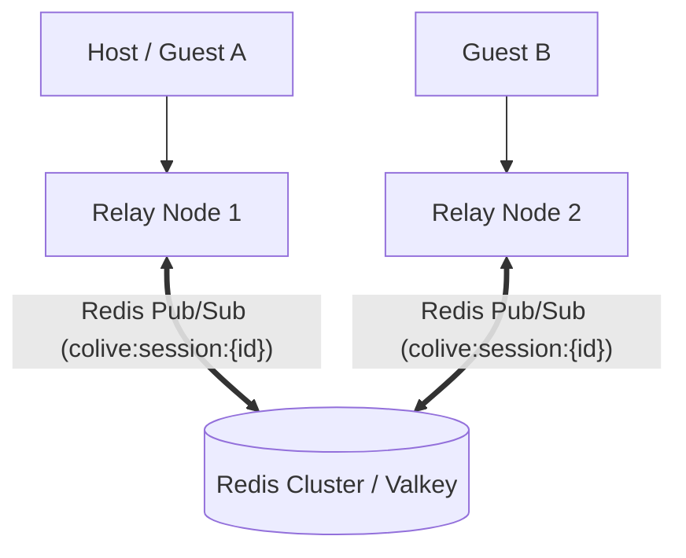

# CoLive Relay Server Deployment Guide 🌐

The CoLive Relay Server is a lightweight, stateless Node.js service that brokers WebSockets, manages session authentication, and fans out binary Yjs CRDT updates and JSON RPCs.

---

## Sizing & Resource Guidelines

The relay holds no persistent disk state. Memory and CPU overhead scale predictably:

| Concurrent Users | Active Sessions | Recommended Sizing | Bandwidth (avg) |
| :--- | :--- | :--- | :--- |
| **1 - 50** | 1 - 10 | 1 vCPU, 512 MB RAM | ~1 - 2 Mbps |
| **50 - 250** | 10 - 50 | 2 vCPU, 2 GB RAM | ~5 - 15 Mbps |
| **250 - 1,000** | 50 - 200 | 4 vCPU, 4 GB RAM | ~25 - 60 Mbps |

---

## 0. Worldwide Collaboration via Cloudflare Tunnel (Zero-Config, Free, Instant)

If you want teammates anywhere in the world to connect to your local relay server without port forwarding, opening firewall ports, or buying a domain, use **Cloudflare Tunnel (TryCloudflare)**:

### Quick Run
```bash
# Run from repository root:
npm run tunnel

# Or execute script directly:
./scripts/tunnel.sh
```

### What This Does:
1. Automatically starts your local relay server on `http://127.0.0.1:8787` (if not already running).
2. Spawns `cloudflared tunnel --url http://127.0.0.1:8787`.
3. Cloudflare allocates a global HTTPS/WSS endpoint (e.g. `https://xxxx.trycloudflare.com` and `wss://xxxx.trycloudflare.com/ws`).
4. Automatically writes the public endpoint to `.tunnel-url` so the CoLive extension discovers it automatically!
5. Teammates anywhere in the world can connect simply by setting `colive.serverUrl` to `wss://xxxx.trycloudflare.com/ws` or running Command: **`CoLive: Set Cloudflare Tunnel URL`**.

---

## 1. Deploying to Fly.io (Dedicated Production)

Fly.io provides low-latency edge deployment with automatic TLS termination and WebSocket support.

### `fly.toml`
Create a `fly.toml` file in `packages/server/`:

```toml
app = "colive-relay"
primary_region = "iad"

[build]
  dockerfile = "Dockerfile"

[env]
  PORT = "8787"
  LOG_LEVEL = "info"
  MAX_PARTICIPANTS = "20"
  SESSION_TTL_HOURS = "24"
  PUBLIC_URL = "https://colive-relay.fly.dev"

[http_service]
  internal_port = 8787
  force_https = true
  auto_stop_machines = false
  auto_start_machines = true
  min_machines_running = 1

  [http_service.concurrency]
    type = "connections"
    hard_limit = 1000
    soft_limit = 800

[[http_service.checks]]
  interval = "15s"
  timeout = "2s"
  grace_period = "5s"
  method = "GET"
  path = "/health"
```

### Deploy Commands
```bash
# Launch and deploy
fly launch --no-deploy
fly deploy packages/server
```

---

## 2. Deploying on a Linux VPS with Docker & Caddy

For maximum privacy and self-hosting control on Ubuntu/Debian:

### `docker-compose.yml`
```yaml
version: '3.8'

services:
  relay:
    image: ghcr.io/colive/relay:latest
    restart: unless-stopped
    environment:
      - PORT=8787
      - LOG_LEVEL=info
      - PUBLIC_URL=https://colive.yourdomain.com
      - MAX_PARTICIPANTS=25
      - SESSION_TTL_HOURS=24
    networks:
      - colive-net

  caddy:
    image: caddy:2-alpine
    restart: unless-stopped
    ports:
      - "80:80"
      - "443:443"
    volumes:
      - ./Caddyfile:/etc/caddy/Caddyfile:ro
      - caddy_data:/data
      - caddy_config:/config
    networks:
      - colive-net

networks:
  colive-net:

volumes:
  caddy_data:
  caddy_config:
```

### `Caddyfile`
Caddy handles automatic Let's Encrypt TLS issuance and WebSocket streaming out of the box:

```caddy
colive.yourdomain.com {
    encode gzip zstd

    reverse_proxy relay:8787 {
        # WebSocket headers
        header_up Host {host}
        header_up X-Real-IP {remote_host}
        header_up X-Forwarded-For {remote_host}
        header_up X-Forwarded-Proto {scheme}
    }
}
```

Start the stack:
```bash
docker compose up -d
```

---

## 3. Deploying to Railway or Render

### Railway
1. Click **New Project** -> **Deploy from GitHub repo**.
2. Set the root directory to `packages/server`.
3. Add environment variables:
   - `PORT=8787`
   - `PUBLIC_URL=https://${{RAILWAY_STATIC_URL}}`
   - `LOG_LEVEL=info`
4. Railway will automatically build the Dockerfile and configure HTTPS/WSS.

### Render
1. Create a **New Web Service** pointing to your repository.
2. Select **Docker** environment.
3. Set Health Check path to `/health`.
4. Deploy.

---

## 4. Multi-Instance Scaling with Redis (Horizontal Scale)

When scaling beyond a single server instance across multiple nodes:



1. **Session Affinity / Storage**: Use Redis key-value store to persist session tokens and participant lists (`SessionStore` interface implementation).
2. **Pub/Sub Fanout**: When Relay Node 1 receives a document update or presence frame for session `X`, it publishes the binary buffer to channel `colive:session:X`.
3. **Local Dispatch**: Relay Node 2 subscribes to `colive:session:X` and fans out the message to its connected local clients belonging to that session.
