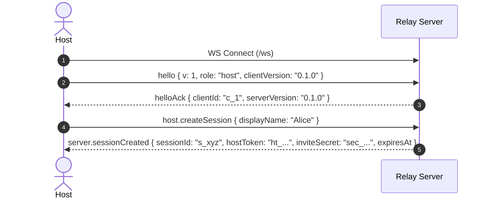
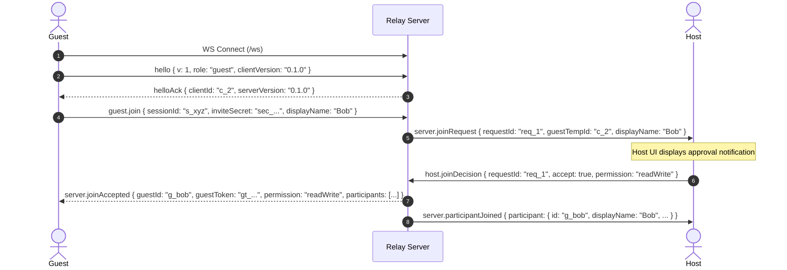
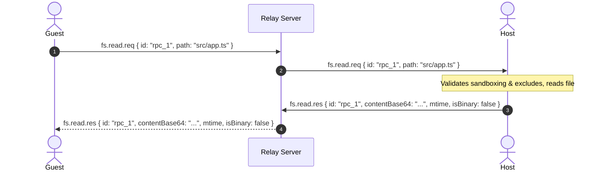

# CoLive Wire Protocol (v1)

This document describes the message specifications, binary framing, and sequence flows used by CoLive.

---

## 1. Transport & Framing

All communication travels over a single WebSocket connection.

### A. JSON Control Messages
Every JSON message has the envelope:
```json
{
  "v": 1,
  "type": "<message.type>",
  "id": "optional-request-or-message-id",
  ...
}
```

### B. Binary Frames
High-throughput CRDT sync and presence updates use compact binary framing:
```
┌──────────────┬────────────────────────┬─────────────────────┬──────────────────┐
│ Kind (1 B)   │ DocId Length (2 B, BE) │ DocId UTF-8 (N B)   │ Payload (M B)    │
│ 0x01 = Doc   │ Uint16                 │ Normalized string   │ Raw Yjs update   │
│ 0x02 = Pres  │                        │ (e.g. "doc_abc123") │ or Awareness     │
└──────────────┴────────────────────────┴─────────────────────┴──────────────────┘
```

---

## 2. Sequence Diagrams

### Create Session & Handshake


### Guest Join with Host Approval


### Workspace File Read RPC


### Collaborative Editing (Yjs Binary)
```mermaid
sequenceDiagram
    autonumber
    actor Guest
    participant Relay as Relay Server
    actor Host
    Guest->>Relay: doc.open.req { id: "op_1", path: "src/app.ts" }
    Relay->>Host: doc.open.req { id: "op_1", path: "src/app.ts" }
    Host-->>Relay: doc.open.res { id: "op_1", docId: "doc_123", initialStateVectorRequired: true }
    Relay-->>Guest: doc.open.res { id: "op_1", docId: "doc_123" }
    Guest->>Relay: [Binary Frame 0x01, "doc_123", Yjs State Vector (Sync Step 1)]
    Relay->>Host: [Binary Frame 0x01, "doc_123", Yjs State Vector]
    Host->>Relay: [Binary Frame 0x01, "doc_123", Yjs Update (Sync Step 2)]
    Relay->>Guest: [Binary Frame 0x01, "doc_123", Yjs Update]
    Note over Guest,Host: Both replicas are in sync; subsequent keystrokes flow as 0x01 binary updates
```

---

## 3. Message Catalog (Example JSON)

### Handshake & Session
```json
// hello
{ "v": 1, "type": "hello", "clientVersion": "0.1.0", "role": "host" }

// helloAck
{ "v": 1, "type": "helloAck", "clientId": "c_9f8a", "serverVersion": "0.1.0" }

// host.createSession
{ "v": 1, "type": "host.createSession", "displayName": "Alice" }

// server.sessionCreated
{
  "v": 1,
  "type": "server.sessionCreated",
  "sessionId": "a8f3kd92jq",
  "hostToken": "ht_d9a184f92",
  "inviteSecret": "Xy7Zb81K9aM...",
  "expiresAt": 1729000000000
}

// guest.join
{
  "v": 1,
  "type": "guest.join",
  "sessionId": "a8f3kd92jq",
  "inviteSecret": "Xy7Zb81K9aM...",
  "displayName": "Bob"
}

// server.joinRequest (Host receives)
{
  "v": 1,
  "type": "server.joinRequest",
  "requestId": "req_101",
  "guestTempId": "c_tmp42",
  "displayName": "Bob"
}

// host.joinDecision
{
  "v": 1,
  "type": "host.joinDecision",
  "requestId": "req_101",
  "accept": true,
  "permission": "readWrite"
}

// server.joinAccepted (Guest receives)
{
  "v": 1,
  "type": "server.joinAccepted",
  "guestId": "p_bob",
  "guestToken": "gt_74f9a",
  "permission": "readWrite",
  "hostInfo": { "id": "p_alice", "role": "host", "displayName": "Alice", "color": "#4363D8", "permission": "readWrite", "status": "active" },
  "participants": []
}

// server.participantJoined
{
  "v": 1,
  "type": "server.participantJoined",
  "participant": { "id": "p_bob", "role": "guest", "displayName": "Bob", "color": "#E6194B", "permission": "readWrite", "status": "active" }
}

// host.setPermission
{ "v": 1, "type": "host.setPermission", "guestId": "p_bob", "permission": "readOnly" }

// host.kick
{ "v": 1, "type": "host.kick", "guestId": "p_bob", "reason": "Idle timeout" }

// server.sessionEnded
{ "v": 1, "type": "server.sessionEnded", "reason": "Host closed session" }
```

### Workspace RPC
```json
// fs.list.req
{ "v": 1, "type": "fs.list.req", "id": "req_1", "path": "src" }

// fs.list.res
{
  "v": 1,
  "type": "fs.list.res",
  "id": "req_1",
  "entries": [
    { "name": "index.ts", "type": "file", "size": 1420, "mtime": 1728900000000 },
    { "name": "utils", "type": "dir", "size": 0, "mtime": 1728900000000 }
  ]
}

// fs.read.req
{ "v": 1, "type": "fs.read.req", "id": "req_2", "path": "src/index.ts" }

// fs.read.res
{
  "v": 1,
  "type": "fs.read.res",
  "id": "req_2",
  "contentBase64": "ZXhwb3J0IGNvbnN0IHggPSAxOw==",
  "mtime": 1728900000000,
  "isBinary": false
}

// fs.watchEvent
{
  "v": 1,
  "type": "fs.watchEvent",
  "changes": [
    { "type": "changed", "path": "src/index.ts" }
  ]
}
```

### Comments, Chat, Diagnostics
```json
// comment.op
{
  "v": 1,
  "type": "comment.op",
  "op": "create",
  "threadId": "t_481",
  "path": "src/index.ts",
  "range": { "startLine": 10, "startChar": 0, "endLine": 11, "endChar": 20 },
  "body": "Should we optimize this query?"
}

// chat.message
{
  "v": 1,
  "type": "chat.message",
  "fromId": "p_alice",
  "fromName": "Alice",
  "text": "Check out line 42",
  "ts": 1728900000000
}

// diagnostics.update
{
  "v": 1,
  "type": "diagnostics.update",
  "path": "src/index.ts",
  "items": [
    {
      "range": { "startLine": 41, "startChar": 2, "endLine": 41, "endChar": 15 },
      "severity": 0,
      "message": "Type 'string' is not assignable to type 'number'.",
      "source": "typescript",
      "code": 2322
    }
  ]
}
```
